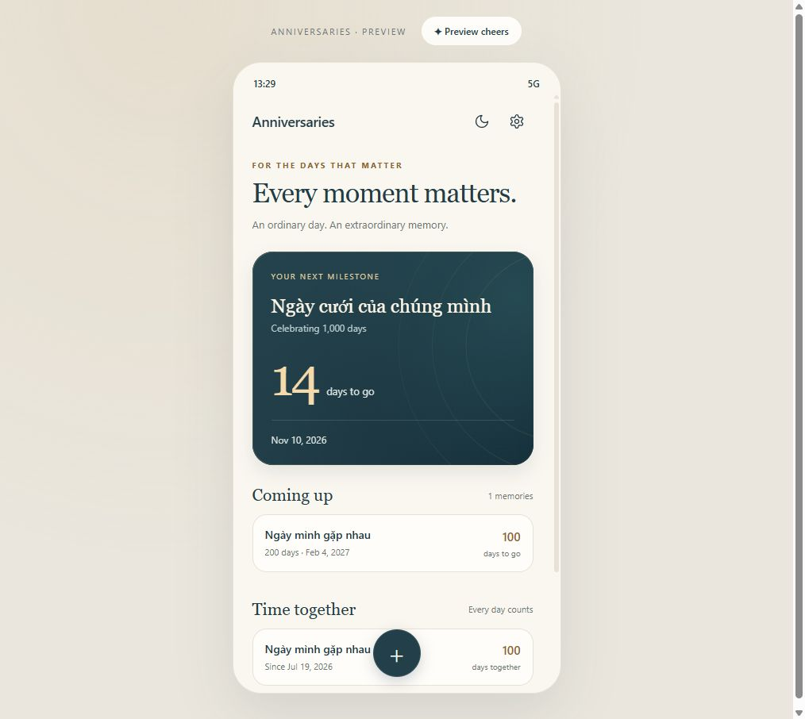
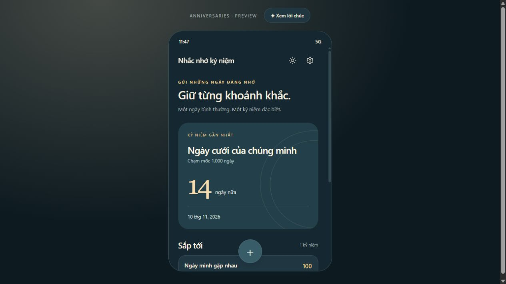
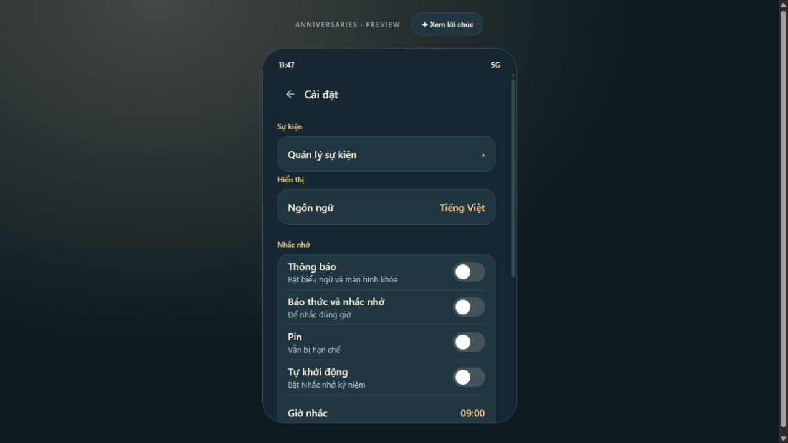
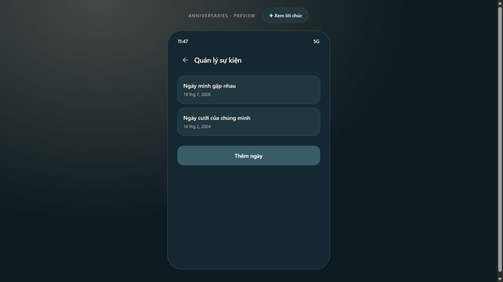
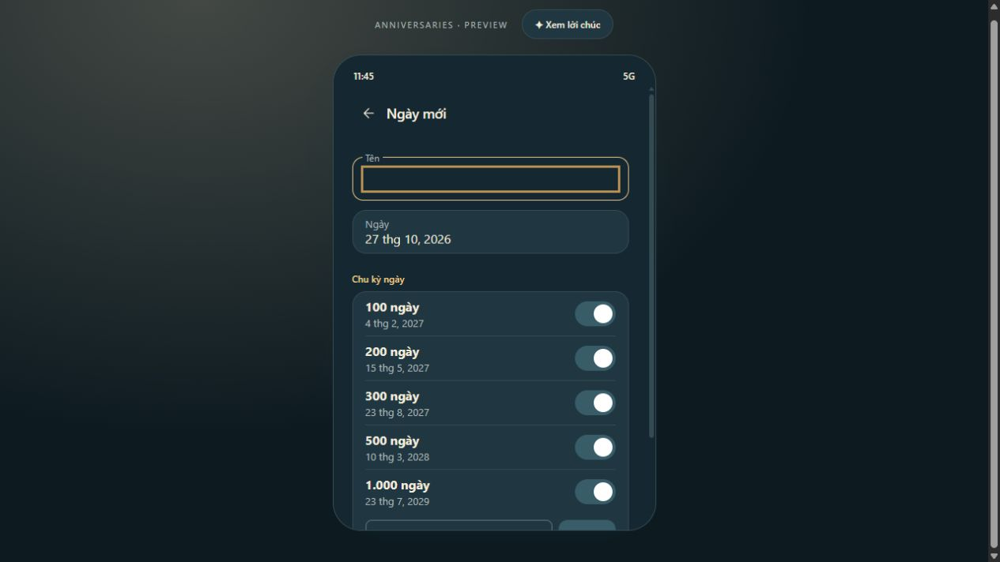

# Anniversaries

An Android app for the dates that matter. It tracks how long it has been and reminds you on the anniversary and on round marks. The interface uses cream, navy, and champagne, with four languages and light and dark themes.

## Prototype

Screenshots are from the HTML, CSS, and Canvas prototype in `prototype/`, using sample data. They are not captures from an Android device. Dates, times, and system controls can look different on a phone.

### Home · Light



### Home · Dark



### Settings



### Manage events



### New event



## Features

- The next milestone card shows the days remaining and the mark coming up.
- **Coming up** and **How long has it been** start with a short list, then **Show more** / **Show less**.
- The title bar stays pinned while scrolling. The round add button sits on the bottom edge, hides while scrolling down, and returns when scrolling up.
- **Settings → Manage events**: add, view, edit, and delete an event. Editing and deleting ask for confirmation.
- Yearly anniversaries. Default day marks are 100, 200, 300, 500, and 1,000 days, and each event can change them. Week and month marks are included in the milestone math.
- Choose the notification time, and an early reminder 1, 3, or 7 days before. The notification title is the event name. The line under it is English, such as “Congratulations on your 100 days anniversary.”
- A **Cheers!** screen with two clinking glasses and fireworks drawn on Canvas. It plays again each time the app is opened on a day that hits a mark.
- Colors, fields, and the date and time pickers follow the light or dark theme.

## Languages

Four languages: **English**, **Tiếng Việt**, **中文**, and **한국어**. Change them in **Settings → Language**. If none is chosen, a Vietnamese, Chinese, or Korean phone opens in that language. Any other phone language opens in English.

Strings live in `app/src/main/res/values` (English), `values-vi`, `values-zh`, and `values-ko`. The prototype in `prototype/index.html` uses the same four languages.

## Stack

| Piece | Technology |
| --- | --- |
| Android | Kotlin, Jetpack Compose, Material 3 |
| Build | Gradle Wrapper 8.13, Android Gradle Plugin 8.13.2, Kotlin 2.3.21 |
| Android SDK | `minSdk 31` (Android 12+), `compileSdk 36`, `targetSdk 36` |
| Checks | JUnit 4 and Android Lint |
| Prototype | Plain HTML, CSS, JavaScript, and Canvas 2D. No npm. |

```text
app/src/main/
  java/com/mine/reminder/
    MainActivity.kt       # Compose screens, navigation, and stored data
    Milestones.kt         # Anniversary and round-mark dates
    Alarm.kt              # Reminder schedule, notifications, and receiver
    Copy.kt               # Locale-aware wording
    Fireworks.kt          # Fireworks and the toast animation
  res/values/             # English
  res/values-vi/          # Tiếng Việt
  res/values-zh/          # 中文
  res/values-ko/          # 한국어
app/src/test/             # Milestone date checks
prototype/                # Interactive browser demo
docs/images/              # Screenshots used in this README
gradle/wrapper/           # Gradle Wrapper, including the JAR kept in Git
```

## Run the prototype

Open `prototype/index.html` in a browser, or serve it if Python 3 is installed:

```powershell
python -m http.server 4173 --bind 127.0.0.1 --directory prototype
```

Then open [http://127.0.0.1:4173](http://127.0.0.1:4173). Use **Preview cheers** to play the animation, and the moon or sun icon to switch theme.

The prototype only imitates the interface. Events and settings stay in memory, and a reload restores the sample data. The permission switches do not grant Android permissions and do not post real notifications.

## Build the Android app

### Setup

1. Install JDK 17, Android SDK Platform 36, and the SDK Build Tools Gradle asks for. Android Studio can install the SDK and sync the project.
2. Open the project root in Android Studio, or set `JAVA_HOME` so Gradle can find the JDK.
3. Create `local.properties` in the project root and point it at this machine's Android SDK. On Windows, replace the path with the real one:

   ```properties
   sdk.dir=C\:/Users/YOUR_USER/AppData/Local/Android/Sdk
   ```

`local.properties` stays off Git. The first build needs a network connection to download Gradle and dependencies.

### Build and check on Windows

```powershell
.\gradlew.bat :app:assembleDebug
.\gradlew.bat :app:assembleRelease
.\gradlew.bat :app:testDebugUnitTest :app:lintDebug
```

APK files are named `Anniversaries-<versionName>-<versionCode>-<buildType>.apk`.

- Debug APK: `app/build/outputs/apk/debug/`.
- Release APK: `app/build/outputs/apk/release/`. A signed release needs `keystore.properties` and `release.keystore` in the project root. Both stay off Git.
- Lint report: `app/build/reports/lint-results-debug.html`.
- Test report: `app/build/reports/tests/testDebugUnitTest/index.html`.

Raise `versionCode` in `app/build.gradle.kts` before each release. Installing that newer signed APK over the copy already on the phone keeps the saved dates. Uninstalling does not.

With an Android 12+ device connected and USB debugging on:

```powershell
.\gradlew.bat :app:installDebug
```

This repo includes `gradlew.bat` for Windows. On macOS or Linux, open the project in Android Studio or use a local Gradle 8.13. The debug APK is for trying the app.

## Data and permissions

Events and settings are stored on the phone with SharedPreferences. There is no account and no server sync. Android backup is off, so uninstalling the app or clearing its data deletes what was saved.

For reminders to fire on time, check **Settings**:

- Notification permission on Android 13+.
- Exact alarms when the system asks.
- Battery optimization and autostart, which depend on the phone maker.

A receiver reschedules reminders after boot, a time or timezone change, and an app update.

## License

Copyright (c) 2026 Dat Nguyen. Personal, non-commercial use only. Commercial use is not allowed. Contact: [thanhxdat@gmail.com](mailto:thanhxdat@gmail.com). The full terms are in [LICENSE](LICENSE).
